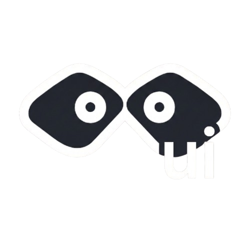
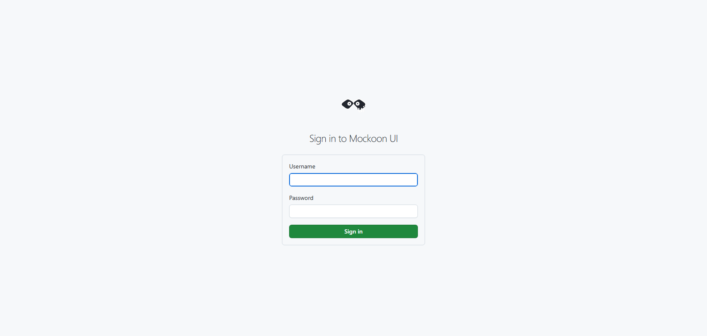
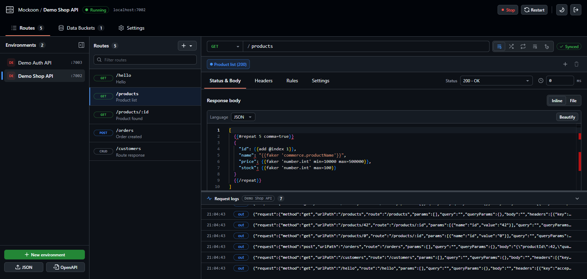
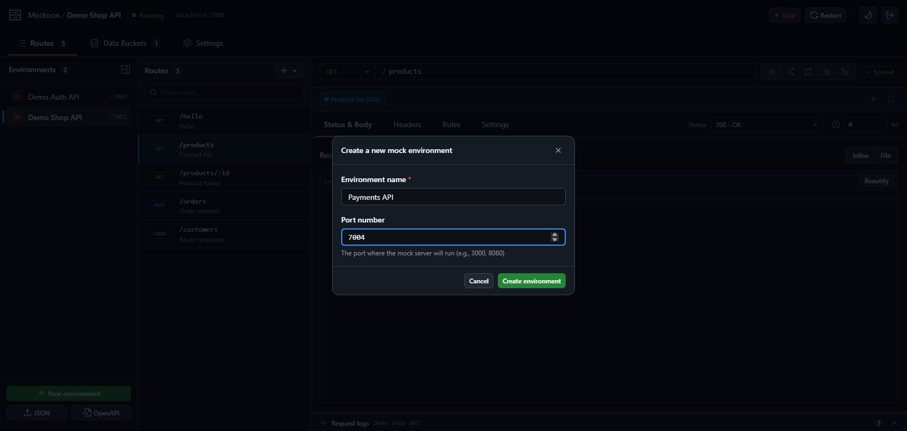
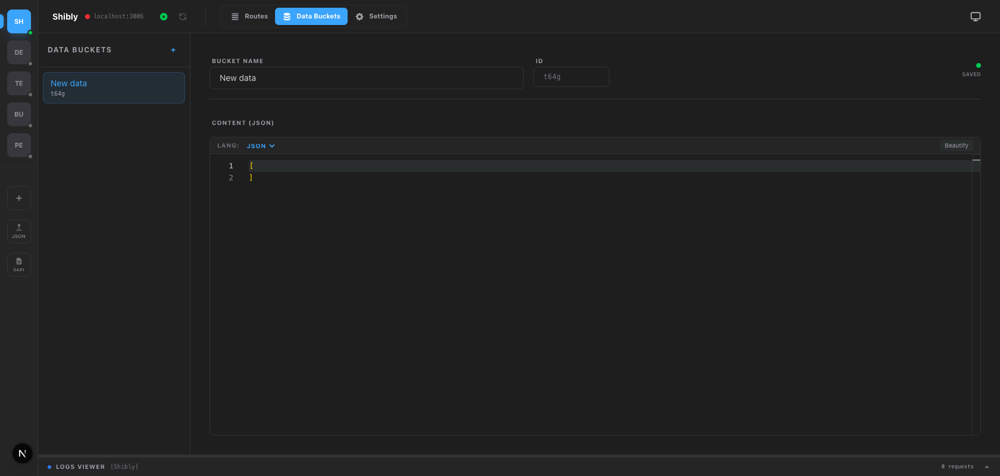
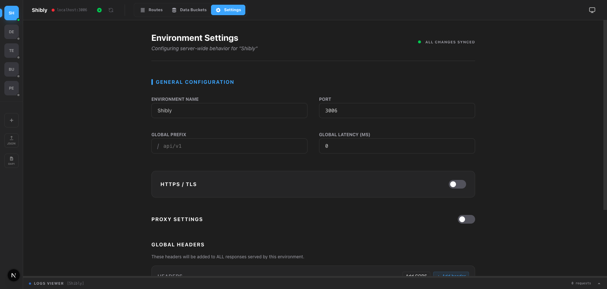

# Mockoon CLI UI

<p align="center">
  
</p>

<p align="center">
  A modern web-based UI for managing Mockoon mock API environments. Built with React 19, Vite, Hono, and Tailwind CSS.
</p>

<p align="center">
  This repository is forked from <a href="https://github.com/oniharnantyo/mockoon-ui">oniharnantyo/mockoon-ui</a>.
</p>

<p align="center">
  <a href="#features">Features</a> •
  <a href="#installation">Installation</a> •
  <a href="#usage">Usage</a> •
  <a href="#development">Development</a> •
  <a href="#api-reference">API Reference</a>
</p>

<p align="center">
  
  
  
  
  
  
</p>

---

## Features

- **Data Buckets** - Create and manage reusable data buckets for your mocks
- **Docker Ready** - Includes Dockerfile and docker-compose for containerized deployment
- **Environment Management** - Create, edit, and manage multiple mock API environments
- **GitHub-style UI** - Follows GitHub's Primer design system (colors, buttons, tabs) with a collapsible sidebar
- **Light & Dark Themes** - Follows the system theme, or pick light/dark manually
- **Login Authentication** - Protects the dashboard with username/password sign-in and session-based access control
- **Mockoon Powered** - Built on top of [Mockoon](https://mockoon.com/) for reliable API mocking
- **OpenAPI Import** - Import OpenAPI/Swagger specifications to auto-generate mock environments
- **Real-time Logs** - Server-Sent Events (SSE) powered live log streaming
- **Route Configuration** - Full support for HTTP methods, headers, responses, and callbacks

## Screenshots

### Login



### Dashboard - Route Editor



### Create New Environment



### Data Buckets Management



### Environment Settings



## Prerequisites

- [mockoon-cli](https://www.npmjs.com/package/@mockoon/cli) (installed as dependency)
- [Node.js](https://nodejs.org/) >= 22.9 (uses `--env-file-if-exists`) and [Yarn](https://classic.yarnpkg.com/) 1.x
- PM2 (installed as dependency)

## Installation

### Clone the repository

```bash
git clone https://github.com/yourusername/mockoon-cli-ui.git
cd mockoon-cli-ui
```

### Install dependencies

```bash
yarn install
```

### Start the development server

```bash
yarn dev
```

Open [http://localhost:7001](http://localhost:7001) with your browser to access the UI. The dev command runs the Vite dev server and the API server (port 7099, proxied under `/api`) together.

Copy `.env.example` to `.env` and set the login credentials first.

### Production

```bash
yarn build
yarn start           # UI + API on http://localhost:7001 (override with PORT or --port)
```

## Usage

### Creating an Environment

1. Click **New environment** at the bottom of the sidebar
2. Enter the environment name and the port the mock server should listen on
3. Add routes, responses, and data buckets as needed

### Importing Environments

- **JSON** (sidebar) - upload an existing Mockoon environment file (`.json`)
- **OpenAPI** (sidebar) - upload an OpenAPI/Swagger specification (`.json`, `.yaml`, `.yml`); routes are generated automatically

### Managing Mock Servers

- Use **Start** / **Stop** / **Restart** in the header to control the selected environment's mock server (run by PM2)
- The **Running** / **Stopped** label next to the environment name shows its status
- Open **Request logs** at the bottom to see incoming requests in real time

### Deleting an Environment

- Hover an environment in the sidebar and click the trash icon, or use **Settings → Danger Zone**
- Its mock server is stopped and removed from PM2; the file is moved to `data/.deleted/` and can be restored by moving it back into `data/`

### Sidebar

- Click the sidebar icon at the top of the sidebar to collapse it to environment initials (hover for the full name) or expand it again
- The collapsed/expanded state is remembered per browser

### Theme

- The theme toggle in the header cycles through **system → light → dark**

## Development

### Available Scripts

| Command              | Description                                             |
| -------------------- | ------------------------------------------------------- |
| `yarn dev`           | Start Vite dev server + API server                      |
| `yarn build`         | Build client (`dist/client`) and server (`dist/server`) |
| `yarn start`         | Start production server                                 |
| `yarn lint`          | Run ESLint                                              |
| `yarn test`          | Run tests                                               |
| `yarn test:watch`    | Run tests in watch mode                                 |
| `yarn test:coverage` | Run tests with coverage report                          |

### Project Structure

```
mockoon-cli-ui/
├── index.html             # Vite HTML entry
├── src/                   # Client entry (main.tsx, App.tsx) and global styles
├── server/                # Hono API server (Node)
│   ├── index.ts           # App wiring, auth, static serving
│   ├── auth.ts            # Login/logout/session + guard
│   └── api/               # API handlers
│       ├── action.ts      # PM2 process control
│       ├── environments/  # CRUD operations
│       └── logs*.ts       # Logs and log streaming (SSE)
├── components/            # React components
│   ├── Dashboard.tsx      # Main application component
│   ├── RouteEditor.tsx    # Route configuration editor
│   ├── RouteList.tsx      # Route listing component
│   ├── Sidebar.tsx        # Environment sidebar
│   ├── LogPanel.tsx       # Real-time log viewer
│   └── ...
├── data/                  # Environment JSON files
├── lib/                   # Utility libraries
├── scripts/               # Server scripts
├── types/                 # TypeScript definitions
├── public/                # Favicons and web manifest
└── images/                # Static images
```

### Key Technologies

- **[Vite](https://vite.dev/)** - Dev server and client build
- **[Hono](https://hono.dev/)** - API server on Node.js
- **[Primer Octicons](https://primer.style/octicons/)** - GitHub icon set
- **[React 19](https://react.dev/)** - UI library
- **[Tailwind CSS 4](https://tailwindcss.com/)** - Utility-first CSS
- **[Monaco Editor](https://microsoft.github.io/monaco-editor/)** - Code editor for responses
- **[Mockoon](https://mockoon.com/)** - API mocking engine
- **[PM2](https://pm2.keymetrics.io/)** - Process manager for mock servers

## API Reference

All endpoints except `/api/auth/*` require a valid session cookie (`401 Unauthorized` otherwise). State-changing requests from another origin are rejected with `403`.

### Auth Endpoints

| Method | Endpoint            | Description                                                             |
| ------ | ------------------- | ----------------------------------------------------------------------- |
| `GET`  | `/api/auth/session` | Whether the current session is valid and login is configured            |
| `POST` | `/api/auth/login`   | Sign in with `{ username, password }` (sets an httpOnly session cookie) |
| `POST` | `/api/auth/logout`  | Sign out                                                                |

### Environment Endpoints

| Method | Endpoint                           | Description                                                                                                         |
| ------ | ---------------------------------- | ------------------------------------------------------------------------------------------------------------------- |
| `GET`  | `/api/environments`                | List all environments in `data/`                                                                                    |
| `POST` | `/api/environments/create`         | Create new environment (`{ name, port }`)                                                                           |
| `POST` | `/api/environments/import`         | Import a Mockoon environment (multipart `file`)                                                                     |
| `POST` | `/api/environments/import-openapi` | Import an OpenAPI spec (multipart `file`)                                                                           |
| `POST` | `/api/environments/update`         | Update environment settings (`{ filename, updatedEnv }`)                                                            |
| `POST` | `/api/environments/delete`         | Delete environment (`{ filename }`): stops its mock server, removes it from PM2, moves the file to `data/.deleted/` |

### Route, Response & Resource Endpoints

Each endpoint takes `{ filename, action, ... }` in the JSON body.

| Method | Endpoint                         | Actions                                                         |
| ------ | -------------------------------- | --------------------------------------------------------------- |
| `POST` | `/api/environments/routes`       | `create`, `delete`, `duplicate`                                 |
| `POST` | `/api/environments/update-route` | Update route metadata (`{ filename, routeUuid, updatedRoute }`) |
| `POST` | `/api/environments/responses`    | `create`, `update`, `delete`, `duplicate`                       |
| `POST` | `/api/environments/databuckets`  | `create`, `update`, `delete`                                    |
| `POST` | `/api/environments/callbacks`    | `create`, `update`, `delete`                                    |
| `POST` | `/api/environments/folders`      | `create`, `update`, `delete`                                    |

### Action Endpoints

| Method | Endpoint      | Description                                                 |
| ------ | ------------- | ----------------------------------------------------------- |
| `GET`  | `/api/action` | List PM2 processes and their status                         |
| `POST` | `/api/action` | `{ command: "start", file }` or `{ command: "stop", name }` |

### Logs Endpoints

| Method | Endpoint                 | Description                        |
| ------ | ------------------------ | ---------------------------------- |
| `GET`  | `/api/logs?name=`        | Last lines of a mock server's logs |
| `GET`  | `/api/logs/stream?name=` | SSE stream for real-time logs      |

## Docker Deployment

The image uses the official `node:22-slim` image and Yarn 1 (bundled with it), no Bun. It is a two-stage build:

1. **Builder** - `yarn install --frozen-lockfile` and `yarn build` (client to `dist/client`, API server to `dist/server`)
2. **Runner** - `yarn install --frozen-lockfile --production`, then copies `dist/`, `scripts/` and `data/`, and starts `node dist/server/index.mjs`

The UI and API listen on port **3000** inside the container. Mock servers are started by PM2 inside the same container on the ports defined in each environment.

`.dockerignore` keeps `node_modules`, `dist` and `.env*` files out of the build context, so credentials are never baked into the image. Pass them at runtime instead.

### Using Docker Compose (recommended)

1. Copy `.env.example` to `.env` next to `docker-compose.yml` and set `MOCKOON_UI_USERNAME`, `MOCKOON_UI_PASSWORD` and `MOCKOON_UI_AUTH_SECRET`
2. Start it:

```bash
docker compose up -d --build
```

3. Open [http://localhost:3000](http://localhost:3000)

The compose file uses `network_mode: host` so every mock server port is reachable without listing ports, and mounts `./data` so environments persist across rebuilds. `network_mode: host` is fully supported on Linux; on Docker Desktop (Windows/macOS) it needs host networking enabled in Docker Desktop settings, or switch to a `ports:` mapping (see the comments in `docker-compose.yml`).

### Using the Dockerfile directly

```bash
docker build -t mockoon-cli-ui .
docker run -d --name mockoon-ui   -p 3000:3000 -p 3001:3001   --env-file .env   -v "$(pwd)/data:/app/data"   mockoon-cli-ui
```

Publish every port your mock environments use (`-p 3001:3001` above is an example), or use `--network host` on Linux.

### Behind a reverse proxy (HTTPS)

Forward `X-Forwarded-Proto: https` (and `X-Forwarded-Host` if the proxy changes the host) so the session cookie gets the `Secure` flag and same-origin checks pass. Alternatively set `MOCKOON_UI_COOKIE_SECURE=true`.

## Environment Variables

| Variable                                      | Description                         | Default                                     |
| --------------------------------------------- | ----------------------------------- | ------------------------------------------- |
| `PORT`                                        | UI/API port                         | `7001` (`3000` in Docker)                   |
| `HOST`                                        | Bind address                        | `0.0.0.0`                                   |
| `MOCKOON_UI_USERNAME` / `MOCKOON_UI_PASSWORD` | Dashboard login                     | –                                           |
| `MOCKOON_UI_AUTH_SECRET`                      | Secret used to sign session cookies | –                                           |
| `MOCKOON_UI_COOKIE_SECURE`                    | Force the Secure cookie flag        | auto (on when `x-forwarded-proto` is https) |

## Contributing

Contributions are welcome! Please feel free to submit a Pull Request.

1. Fork the repository
2. Create your feature branch (`git checkout -b feature/amazing-feature`)
3. Commit your changes (`git commit -m 'Add some amazing feature'`)
4. Push to the branch (`git push origin feature/amazing-feature`)
5. Open a Pull Request

## License

This project is licensed under the MIT License - see the [LICENSE](LICENSE) file for details.

## Acknowledgments

- [Mockoon](https://mockoon.com/) - The amazing API mocking tool this project is built upon
- [GitHub Primer](https://primer.style/) - Design system the UI styling is based on
- [Tailwind CSS](https://tailwindcss.com/) - For the beautiful styling

---

<p align="center">
  Maintained by the Mockoon CLI UI contributors
</p>
