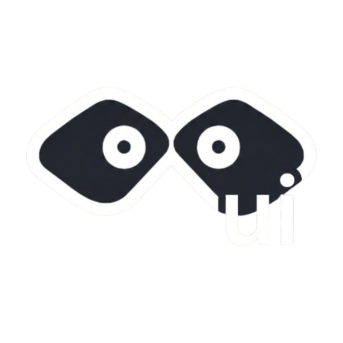
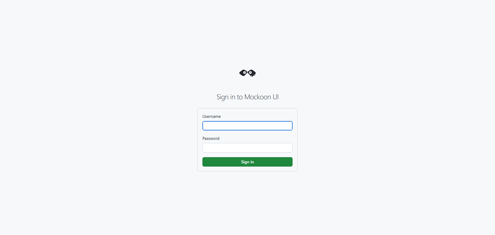
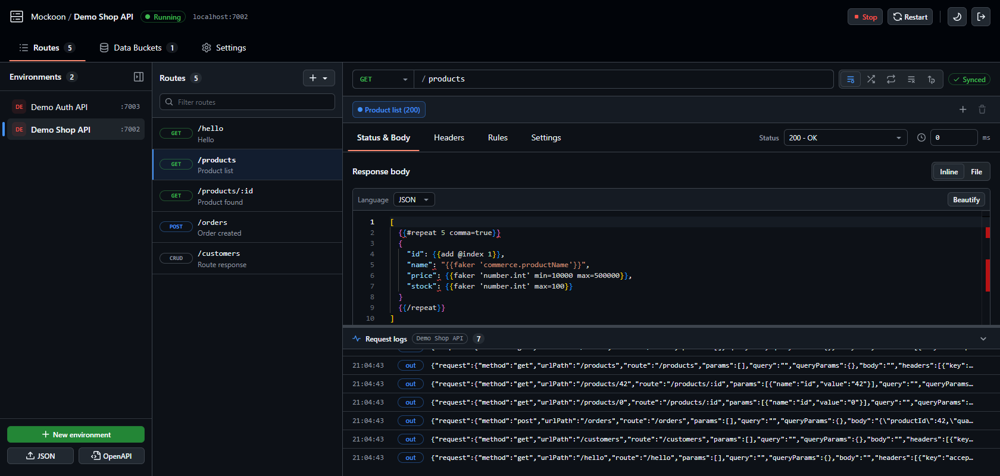
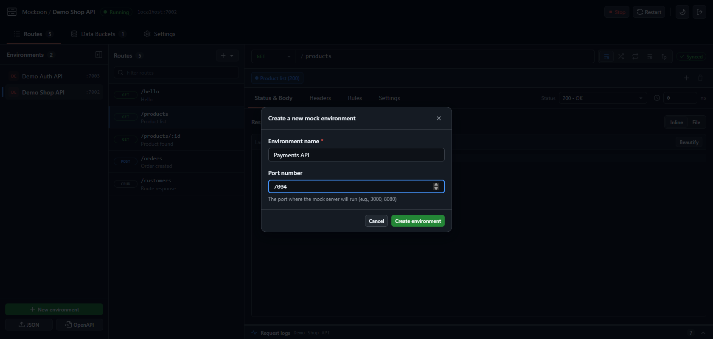
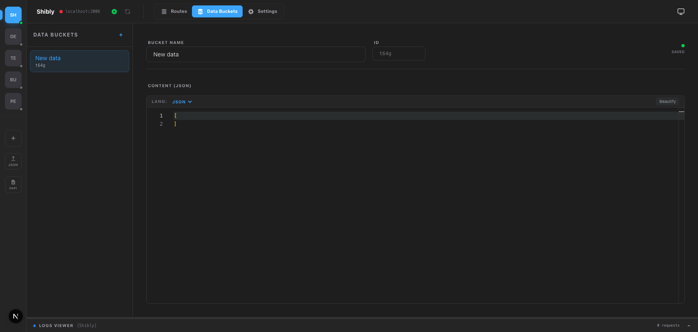
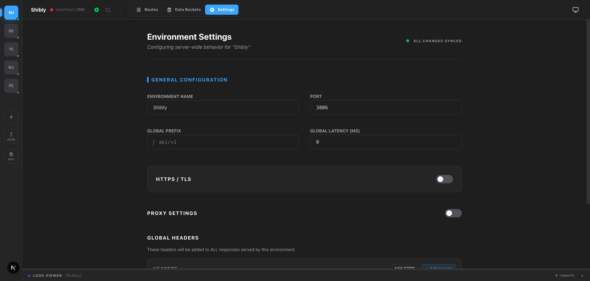

# Mockoon CLI UI

<p align="center">
  
</p>

<p align="center">
  A modern web-based UI for managing Mockoon mock API environments. Built with React 19, Vite, Hono, and Tailwind CSS.
</p>

<p align="center">
  This repository is forked from <a href="https://github.com/oniharnantyo/mockoon-ui">oniharnantyo/mockoon-ui</a>.
</p>

<p align="center">
  <a href="#features">Features</a> •
  <a href="#installation">Installation</a> •
  <a href="#first-run-setup">First-Run Setup</a> •
  <a href="#usage">Usage</a> •
  <a href="#development">Development</a> •
  <a href="#api-reference">API Reference</a>
</p>

<p align="center">
  
  
  
  
  
  
</p>

---

## Features

### Environments

- **Create & manage** - Several mock API environments side by side, each with its own port and mock server
- **Duplicate** - Copy an environment in one click as `<name> (copy 1)`, on the next free port so both can run
- **Import** - Upload a Mockoon environment (**JSON**) or an OpenAPI/Swagger spec (**OpenAPI**) to generate one
- **Export** - Download any environment as a Mockoon file, ready to import again or open in Mockoon desktop
- **Server status at a glance** - Every environment in the sidebar shows whether its mock server is running, starting, crashed or stopped

### Routes & Folders

- **Route editor** - HTTP, CRUD and WebSocket routes with methods, headers, rules, responses and callbacks
- **Folders** - Group routes in folders and subfolders; drag and drop to reorganise
- **Resizable panels** - Drag the edge of the environments sidebar or the route list (200-480 px); widths are remembered
- **Duplicate** - Copy a route (`/users-copy-1`) or a whole folder (`Users (copy 1)`) next to the original
- **Copy or move to another environment** - Routes and folders, with the data buckets and callbacks they use
- **Export & import routes** - Save a route or folder to a file named like `demo-shop-api-get-users.json` and import it into any environment, or into a new one
- **Data buckets** - Reusable data for your responses

### Safe Deletes

- **Nothing is lost by accident** - Deleted environments **and** deleted routes go to the recycle bin first
- **Restore** - Environments come back on a free port; routes go back to their environment and folder
- **Smart fallback** - A route whose environment is gone can be restored into another environment of your choice
- **Delete permanently** - One item at a time, or empty the whole bin

### Ports & Servers

- **Port range & picker** - Mock servers only use ports from an allowed range, each at most once; ports are picked from a list showing which are taken
- **Change the range anytime** - Widen or narrow it from **Account**, no restart or new setup needed
- **Firewall hints** - The exact commands to open the ports for ufw, firewalld or Windows Firewall
- **Real-time logs** - Live request logs, streamed with Server-Sent Events (SSE)

### Access & Setup

- **First-run setup** - Sets the login, the UI port and the mock server port range; no `.env` needed
- **Login** - Username/password sign-in (password stored as a scrypt hash) with session-based access
- **Account management** - Change the username, password or port range, or run the setup again; a forgotten password can be reset from `.env`

### Interface

- **GitHub look & feel** - Follows GitHub's Primer design system: buttons, menus, dialogs, tabs and colours
- **Tidy action menus** - One **⋯** menu per environment, route and folder, with icon + label items, instead of a row of buttons
- **Works on phones and tablets** - Single-pane layout on small screens, touch-friendly menus, nothing cut off
- **Light & dark themes** - Follows the system theme, or pick one manually
- **Clear feedback** - Notifications can be dismissed; every destructive action asks for confirmation first

### Deployment

- **Docker ready** - Dockerfile and docker-compose included
- **Mockoon powered** - Built on [Mockoon](https://mockoon.com/) for reliable API mocking

## Screenshots

### Login



### Dashboard - Route Editor



### Create New Environment



### Data Buckets Management



### Environment Settings



## Prerequisites

- [mockoon-cli](https://www.npmjs.com/package/@mockoon/cli) (installed as dependency)
- [Node.js](https://nodejs.org/) >= 22.9 (uses `--env-file-if-exists`) and [Yarn](https://classic.yarnpkg.com/) 1.x
- PM2 (installed as dependency)

## Installation

### Clone the repository

```bash
git clone https://github.com/yourusername/mockoon-cli-ui.git
cd mockoon-cli-ui
```

### Install dependencies

```bash
yarn install
```

### Start the development server

```bash
yarn dev
```

Open [http://localhost:7001](http://localhost:7001) with your browser to access the UI. The dev command runs the Vite dev server and the API server (port 7099, proxied under `/api`) together.

On first run the UI opens the [setup page](#first-run-setup). In development the API port is fixed by the dev script (`--port 7099`, Vite serves the UI on 7001), so the setup shows the UI port as locked and only asks for the login and the mock server port range.

### Production

```bash
yarn build
yarn start           # UI + API on the setup port, 7001 by default (PORT or --port override it)
```

With PM2 (recommended for servers):

```bash
yarn build
pm2 start ecosystem.config.cjs
pm2 logs mockoon-ui  # startup messages, e.g. "First-run setup required"
```

### Upgrading an existing installation

- **`ecosystem.config.cjs` no longer passes `--port 7001`**, so the port chosen in the setup is used. `pm2 restart` keeps the old arguments, so reload the app once: `pm2 delete mockoon-ui && pm2 start ecosystem.config.cjs`
- **`.env` is now optional.** If it still sets `MOCKOON_UI_USERNAME` / `MOCKOON_UI_PASSWORD`, those keep working and win over the setup (the setup then only asks for the ports). Comment them out to manage the login from the UI instead
- **Existing environments keep their ports.** Starting one whose port is outside the new range or shared with another environment is refused with a message; pick a new port in its **Settings**
- **`data/` is no longer committed** except the `demo-*.json` samples (see `.gitignore`), so your own environments stay local

## First-Run Setup

The first time the UI starts (no `config/settings.json` yet) it opens a setup page instead of the login. The server log prints `First-run setup required` until it is done.

The page has two columns:

| Section    | Field                  | Notes                                                                                                                                                 |
| ---------- | ---------------------- | ----------------------------------------------------------------------------------------------------------------------------------------------------- |
| **Access** | Username               | 1-64 characters                                                                                                                                       |
|            | Password / Confirm     | At least 8 characters. The eye icon shows or hides the value; a mismatch is flagged while typing and blocks saving. Hidden when `.env` sets the login |
| **Ports**  | Mockoon UI port        | Port of this dashboard (default 7001). Locked when `PORT` or `--port` is set                                                                          |
|            | Mock server port range | Ports mock servers may use, e.g. `7002`-`7020`. Must not include the UI port. Locked when `MOCKOON_PORT_RANGE` is set                                 |
|            | Firewall               | Commands to open the UI port and the range, each with a copy button (see [Firewall](#firewall)). Only shown, never run                                |

After **Save and continue**:

- The answers are saved in `config/settings.json`: the password as a salted scrypt hash and a random secret for session cookies. The file is written with owner-only permissions and is ignored by Git and Docker builds
- You are signed in right away
- If the UI port changed, the server starts listening on the new port, closes the old one and the browser follows to the new address. No restart is needed
- The setup page is locked (`409`) until the setup is reset

> **Security:** until the setup is completed, anyone who can reach the UI can fill it in and choose the admin password. Complete it right after the first start, before opening the UI port to other machines.

### Configuration priority

Values in `.env` (or the process environment) always win over the setup, which is how a forgotten password is reset:

| Setting           | Taken from (first match)                                      |
| ----------------- | ------------------------------------------------------------- |
| Login             | `MOCKOON_UI_USERNAME` + `MOCKOON_UI_PASSWORD` → setup         |
| Session secret    | `MOCKOON_UI_AUTH_SECRET` → setup (generated)                  |
| UI port           | `--port` → `PORT` → setup → `7001`                            |
| Mock port range   | `MOCKOON_PORT_RANGE` → setup → any port (1-65535)             |
| Firewall commands | `MOCKOON_FIREWALL` → detected from the OS (`windows` / `ufw`) |

## Usage

### Account & Login

Open **Account** with the person icon in the header (next to **Sign out**).

**Change username or password**

1. Edit **Username** and/or type a **New password** with its confirmation (leave the new password empty to keep the current one)
2. Enter your **Current password** and click **Save login**
3. A new password signs out every other browser; this one stays signed in

The form is read-only while `.env` sets the login.

**Forgot the password?**

1. Set `MOCKOON_UI_USERNAME` and `MOCKOON_UI_PASSWORD` in `.env` on the server
2. Restart the UI and sign in with them
3. To go back to the login from the setup, remove both lines and restart (or keep them; `.env` simply wins)

**Change the mock server port range**

1. In **Account**, under **Mock server port range**, change **from** and/or **to** (e.g. `7002`-`7020` to `7002`-`7050`)
2. Click **Save range**. It applies right away; no restart or setup reset is needed, and the login and running mock servers are kept
3. Open the new range in the firewall: the dialog shows the commands once the range is changed (see [Firewall](#firewall))

The range must not include the UI port, and it cannot be narrowed while an environment still uses a port outside the new range (move it first in its **Settings → Port**). The section is read-only while `MOCKOON_PORT_RANGE` is set.

**Run the setup again**

1. In **Account**, in the red box, click **Run setup again…**
2. Type your username and password to confirm, then click **Reset and run setup**
3. `config/settings.json` is deleted, everyone is signed out and the [setup page](#first-run-setup) opens, prefilled with the port the UI is running on

Environments and running mock servers are not touched. As with the first run, complete the setup right away. Deleting `config/settings.json` and restarting does the same from the server.

### Creating an Environment

1. Click **New environment** at the bottom of the sidebar
2. Enter the environment name and pick the port from the list (the next free port is preselected)
3. Add routes, responses, and data buckets as needed

**Duplicate an environment:** open its **⋯** menu in the sidebar → **Duplicate environment**. The copy is called `<name> (copy 1)` (then `(copy 2)`, …), gets the first free port of the range and its own file, and is selected right away. Routes, folders, responses, data buckets and callbacks are all copied; its mock server starts stopped.

### Working with Routes & Folders

Every route and folder has a **⋯** button (it appears on hover; on touch screens it is always visible). Its menu:

| Item                     | Route | Folder | What it does                                                                                       |
| ------------------------ | :---: | :----: | -------------------------------------------------------------------------------------------------- |
| **Add to folder…**       |       |   ✓    | New HTTP / CRUD / WebSocket route or subfolder inside it, or **Import from file…** into it           |
| **Rename**               |       |   ✓    | Edit the name in place (Enter saves, Esc cancels); double-clicking the name does the same          |
| **Duplicate**            |   ✓   |   ✓    | Copy right below the original: a route gets its own path (`/users` → `/users-copy-1`), a folder becomes `Users (copy 1)` |
| **Move to folder…**      |   ✓   |   ✓    | Pick a folder of the same environment, or the top level                                            |
| **Copy to environment…** |   ✓   |   ✓    | See below                                                                                          |
| **Move to environment…** |   ✓   |   ✓    | See below                                                                                          |
| **Export to file**       |   ✓   |   ✓    | See below                                                                                          |
| **Delete**               |   ✓   |   ✓    | A route goes to the **Recycle bin**; deleting a folder keeps its contents, which move up one level   |

More ways to organise:

- **+ ▾ → Folder** in the route list adds a folder at the top level and opens its name for editing
- **Drag and drop** a route or folder onto a folder, or onto the empty area below the list to bring it to the top level
- The **filter** searches inside folders and opens the ones with matches

Folders only group routes in the UI; they are saved in the environment file the same way Mockoon desktop saves them.

#### Copy or move to another environment

**⋯ → Copy to environment…** or **Move to environment…** opens a dialog that reads from top to bottom:

1. **Action** - *Copy* adds a copy and leaves the original in place; *Move* removes it from where it is. The line under it says which
2. **From** (grey, read-only) - the route or folder, and the environment, port and folder it is in now
3. **To** (blue) - pick the target **Environment** and **Folder** (or *Top level*)
4. Click **Copy now** / **Move now**

- A folder travels with everything inside it, subfolders included
- **Data buckets and callbacks** the routes use come along when the target does not have them yet, so `{{data 'users'}}` keeps working
- Everything gets new IDs, so the same item can be copied twice
- If the target already has a route with the same method and path, or a different bucket with the same ID, the dialog lists it after copying so you can check
- Restart running mock servers to apply the change

#### Export and import routes

**⋯ → Export to file** downloads a route or folder (with the data buckets and callbacks it uses) as one file, named after where it came from:

| Exported item          | File name                                 |
| ---------------------- | ----------------------------------------- |
| `GET /users` route      | `demo-shop-api-get-users.json`            |
| CRUD `/customers` route | `demo-shop-api-crud-customers.json`      |
| WebSocket `/live` route | `demo-shop-api-ws-live.json`              |
| `Accounts` folder       | `demo-shop-api-folder-accounts.json`      |

To import such a file:

- **In the route list:** **+ ▾ → Import from file…** (top level), or a folder's **⋯ → Add to folder… → Import from file…** (into that folder)
- **From the sidebar:** the **JSON** button recognises a routes export and asks **where the routes should go**:
  - **Add to an existing environment** - pick the environment (the open one is preselected) and the folder
  - **Create a new environment** - give it a name; it gets the next free port

A whole Mockoon environment file can also be imported into an existing environment from the route list; all its routes and folders are added. Files up to 10 MB are accepted, and each import gets new IDs, so the same file can be imported several times.

### Mock Server Ports

Two mock servers cannot listen on the same port: the second one fails to start and requests reach the first one (typically answering `404` for routes of the other environment). Mockoon UI therefore enforces:

- **One port per environment.** Creating, importing, editing or starting an environment with a port already used by another environment is refused
- **Ports from the allowed range only** (setup or **Account → Mock server port range**, or `MOCKOON_PORT_RANGE` such as `7002-7020`). Without a range any port is accepted, but still only once
- **Never the UI port**

**Port picker.** In **New environment** and in an environment's **Settings → Port**, the port is chosen from a list of every port in the range:

- free ports can be selected; the next free one is preselected for new environments
- taken ports are shown but disabled, with their owner, e.g. `7003 (used by Demo Auth API)` or `7001 (used by Mockoon UI)`
- an older environment whose port is outside the range shows it as `(outside 7002-7020, pick another)`
- in **Settings** the new port is saved as soon as it is picked; restart the mock server to apply it
- without a range (or with a range larger than 1000 ports) the picker falls back to a number field

**Imports** keep the port from the file when it is free and inside the range; otherwise they get the next free port automatically. If the range is full, the import is refused.

#### Firewall

Open the UI port and the mock range once on the server. The setup page shows the matching commands for the firewall set in `MOCKOON_FIREWALL`: `ufw`, `firewalld`, `windows`, or `none` to hide them. When unset it follows the OS (Windows Firewall on Windows, `ufw` on Linux). Mockoon UI never changes the firewall itself, so it does not need root or administrator rights.

```bash
# ufw
sudo ufw allow 7001/tcp
sudo ufw allow 7002:7020/tcp

# firewalld
sudo firewall-cmd --permanent --add-port=7001/tcp --add-port=7002-7020/tcp
sudo firewall-cmd --reload

# Windows (PowerShell as Administrator)
New-NetFirewallRule -DisplayName "Mockoon UI" -Direction Inbound -Protocol TCP -LocalPort 7001 -Action Allow
New-NetFirewallRule -DisplayName "Mockoon mock servers" -Direction Inbound -Protocol TCP -LocalPort 7002-7020 -Action Allow
```

A port that is allowed in the firewall but has no mock server running simply refuses connections, so opening the whole range once is safe. Restart the UI after changing `MOCKOON_PORT_RANGE` or `MOCKOON_FIREWALL`.

### Importing Environments

- **JSON** (sidebar) - upload an existing Mockoon environment file (`.json`). A routes export (see [Export and import routes](#export-and-import-routes)) opens a dialog that asks which environment the routes go to, or whether to create a new one
- **OpenAPI** (sidebar) - upload an OpenAPI/Swagger specification (`.json`, `.yaml`, `.yml`); routes are generated automatically

### Exporting an Environment

1. Open the environment's **⋯** menu in the sidebar
2. Click **Export environment**
3. The browser saves `<name>.json`

The download is the environment file exactly as stored in `data/`, including every edit made in the UI, in the Mockoon environment format. It can be imported again here (**JSON** button) or opened in Mockoon desktop/CLI.

Exporting right after importing returns the uploaded file unchanged, except:

- `uuid`: every import gets a new one, so the same file can be imported twice without conflicts
- `port`: only if the import had to move it into the allowed range or away from a taken port

### Managing Mock Servers

- Use **Start** / **Stop** / **Restart** in the header to control the selected environment's mock server (run by PM2)
- The **Running** / **Stopped** label next to the environment name shows its status
- Starting is refused with a clear message when the port is outside the range or used by another environment
- Open **Request logs** at the bottom to see incoming requests in real time

**Status in the sidebar.** Every environment's avatar has a status dot, so all mock servers are visible at once (also when the sidebar is collapsed; hover for the label):

| Dot    | Status   | Meaning                                             |
| ------ | -------- | --------------------------------------------------- |
| Green  | Running  | The mock server is online                           |
| Yellow | Starting | PM2 is starting or restarting it                    |
| Red    | Error    | It crashed, e.g. because its port is already in use |
| Grey   | Stopped  | Stopped, or never started                           |

The status refreshes every 10 seconds and immediately after **Start** / **Stop**.

### Deleting

Every delete asks for confirmation in a dialog (**Cancel** or clicking outside closes it without deleting):

| What        | Where                                                   | The dialog shows                                                       | Can be restored |
| ----------- | ------------------------------------------------------- | ---------------------------------------------------------------------- | :-------------: |
| Environment | **⋯ → Delete environment…** in the sidebar, or **Settings → Danger Zone** | Its port and that it goes to the recycle bin | ✓ |
| Route       | **⋯ → Delete route** in the route list                  | Method, path and number of responses, e.g. `GET /users` and 2 responses | ✓ |
| Folder      | **⋯ → Delete folder**                                   | Folder name; its routes and subfolders move up one level instead of being deleted | (nothing is deleted) |
| Response    | Trash icon next to the response tabs                    | The response label                                                     |                 |
| Data bucket | × on hover in the data bucket list                      | The bucket name and the `{{data 'id'}}` reference that will break      |                 |

Deleting an environment stops its mock server and removes it from PM2; the file is moved to the **Recycle bin** (`data/.deleted/`). A deleted route is saved there too, with the data buckets and callbacks it uses. Deleting a response or data bucket removes it from the file and cannot be undone.

### Recycle Bin

**Recycle bin** at the bottom of the sidebar (with the number of items) lists everything deleted, newest first. Each item shows what it is (*Environment*, *Route*, *Folder*), when it was deleted and, for routes, where it came from, e.g. *from Demo Shop API › Accounts*.

**Restoring an environment** puts it back in the sidebar and selects it. Its mock server stays stopped until you start it.

- The old port is kept when it is still inside the allowed range, not assigned to another environment, not the UI port and nothing else listens on it; otherwise the first port that meets all of these is used, and the notification says which port changed
- If the range has no free port left, restoring is refused and the item stays in the bin (widen the range in **Account**)
- If an environment with the same file name exists, it is restored as `<name>-restored.json`; if one with the same uuid exists (e.g. imported again), it gets a new uuid

**Restoring a route** puts it back into its environment and folder, and opens it.

- If its folder was deleted meanwhile, it goes to the top level (the notification says so)
- If its **environment** was deleted, the item is marked *(deleted)* and **Restore** asks where it should go instead: pick another environment and folder, then **Restore to …**. Restoring the environment first works too
- Its data buckets and callbacks come back with it when the environment no longer has them

**Removing for good:** the trash icon on an item (**Delete permanently**) or **Empty recycle bin**, both after a confirmation. Files in `data/.deleted/` that cannot be read are shown as *Unreadable* and can only be deleted.

### Sidebar

- Click the sidebar icon at the top of the sidebar to collapse it to environment initials (hover for the full name and status) or expand it again
- **Resize** by dragging its right edge: right to widen, left to narrow, between **200 px** and **480 px** (default 256 px). Double-click the edge to reset. The **route list** next to it resizes the same way, with the same limits (default 320 px)
- With the keyboard: **Tab** to the edge, then **←** / **→** (hold **Shift** for bigger steps), **Home** for the minimum, **End** for the maximum
- Each environment has a **⋯** menu: **Duplicate environment**, **Export environment**, **Delete environment…**
- **Recycle bin** at the bottom opens the [recycle bin](#recycle-bin); it shows how many items are waiting
- The widths of both panels and the collapsed/expanded state are remembered per browser

### On Phones and Small Screens

Below 768 px wide the dashboard switches to a single-pane layout:

- The sidebar becomes a narrow rail of environment icons; the sidebar button opens the full list over the page, and picking an environment closes it again
- The route list takes the full width; opening a route shows the editor full screen with **← Routes** to go back
- The header keeps the essentials: the status becomes a coloured dot and **Restart** an icon
- **⋯** buttons are always visible (touch screens cannot hover), and menus and dialogs always fit the screen
- Tabs and wide toolbars wrap or scroll sideways instead of being cut off

### Notifications

Notifications appear at the bottom left (full width on phones). They close by themselves after a few seconds (longer for long messages and errors), or right away with **×**.

### Theme

- The theme toggle in the header cycles through **system → light → dark**

## Development

### Available Scripts

| Command              | Description                                             |
| -------------------- | ------------------------------------------------------- |
| `yarn dev`           | Start Vite dev server + API server                      |
| `yarn build`         | Build client (`dist/client`) and server (`dist/server`) |
| `yarn start`         | Start production server                                 |
| `yarn lint`          | Run ESLint                                              |
| `yarn test`          | Run tests                                               |
| `yarn test:watch`    | Run tests in watch mode                                 |
| `yarn test:coverage` | Run tests with coverage report                          |

### Project Structure

```
mockoon-cli-ui/
├── index.html             # Vite HTML entry
├── src/                   # Client entry (main.tsx, App.tsx) and global styles
├── server/                # Hono API server (Node)
│   ├── index.ts           # App wiring, auth, static serving, UI port switching
│   ├── auth.ts            # Login/logout/session + guard
│   ├── setup.ts           # First-run setup
│   ├── account.ts         # Change login, run setup again
│   ├── lib/
│   │   ├── settings.ts    # config/settings.json, password hashing, .env overrides
│   │   ├── port-range.ts  # Allowed range, port conflict checks, free port search
│   │   ├── route-bundle.ts # Copy/move/duplicate/export/import of routes and folders
│   │   └── route-trash.ts # Deleted routes in the recycle bin
│   └── api/               # API handlers
│       ├── action.ts      # PM2 process control
│       ├── environments/  # CRUD, import/export, ports, duplicate, transfer, recycle bin
│       └── logs*.ts       # Logs and log streaming (SSE)
├── components/            # React components
│   ├── Dashboard.tsx      # Main application component
│   ├── RouteEditor.tsx    # Route configuration editor
│   ├── RouteList.tsx      # Route listing component
│   ├── Sidebar.tsx        # Environment sidebar
│   ├── LogPanel.tsx       # Real-time log viewer
│   ├── SetupPage.tsx      # First-run setup page
│   ├── AccountButton.tsx  # Account dialog
│   ├── RecycleBinDialog.tsx   # Recycle bin
│   ├── TransferDialog.tsx     # Copy/move to another environment
│   ├── ImportRoutesDialog.tsx # Where imported routes go
│   ├── shared/            # ActionMenu, PortSelect, PasswordInput, ConfirmDialog, ...
│   └── ...
├── config/                # settings.json from the setup (not committed)
├── data/                  # Environment JSON files (only demo-* are committed)
├── lib/                   # Utility libraries
├── scripts/               # Server scripts
├── types/                 # TypeScript definitions
├── public/                # Favicons and web manifest
└── images/                # Static images
```

### Key Technologies

- **[Vite](https://vite.dev/)** - Dev server and client build
- **[Hono](https://hono.dev/)** - API server on Node.js
- **[Primer Octicons](https://primer.style/octicons/)** - GitHub icon set
- **[React 19](https://react.dev/)** - UI library
- **[Tailwind CSS 4](https://tailwindcss.com/)** - Utility-first CSS
- **[Monaco Editor](https://microsoft.github.io/monaco-editor/)** - Code editor for responses
- **[Mockoon](https://mockoon.com/)** - API mocking engine
- **[PM2](https://pm2.keymetrics.io/)** - Process manager for mock servers

## API Reference

All endpoints except `/api/auth/*` and `/api/setup` require a valid session cookie (`401 Unauthorized` otherwise). State-changing requests from another origin are rejected with `403`.

### Auth Endpoints

| Method | Endpoint            | Description                                                                       |
| ------ | ------------------- | --------------------------------------------------------------------------------- |
| `GET`  | `/api/auth/session` | Whether the session is valid, login is configured and the setup is still required |
| `POST` | `/api/auth/login`   | Sign in with `{ username, password }` (sets an httpOnly session cookie)           |
| `POST` | `/api/auth/logout`  | Sign out                                                                          |

### Setup & Account Endpoints

| Method | Endpoint             | Description                                                                                                                        |
| ------ | -------------------- | ---------------------------------------------------------------------------------------------------------------------------------- |
| `GET`  | `/api/setup`         | What the setup needs (`needsCredentials`, UI port, port range, which fields are locked, firewall); `{ required: false }` when done |
| `POST` | `/api/setup`         | Save the setup (`{ username, password, uiPort, mockPortMin, mockPortMax }`) and sign in; `409` once done                           |
| `GET`  | `/api/account`       | Current username and whether `.env` sets the login                                                                                 |
| `POST` | `/api/account`       | Change the login (`{ currentPassword, username, newPassword? }`); `409` while `.env` sets it                                       |
| `GET`  | `/api/account/port-range` | Mock server port range, whether `MOCKOON_PORT_RANGE` locks it, UI port and firewall                                         |
| `POST` | `/api/account/port-range` | Change the range (`{ min, max }`); `400` if it contains the UI port or leaves an environment outside; `409` while locked |
| `POST` | `/api/account/reset` | Run the setup again (`{ username, password }`): deletes `config/settings.json` and signs everyone out                              |

### Environment Endpoints

| Method | Endpoint                           | Description                                                                                                         |
| ------ | ---------------------------------- | ------------------------------------------------------------------------------------------------------------------- |
| `GET`  | `/api/environments`                | List all environments in `data/`                                                                                    |
| `POST` | `/api/environments/create`         | Create new environment (`{ name, port }`)                                                                           |
| `POST` | `/api/environments/import`         | Import a Mockoon environment (multipart `file`)                                                                     |
| `GET`  | `/api/environments/export`         | Download an environment as a Mockoon file (`?filename=<name>.json`)                                                 |
| `POST` | `/api/environments/import-openapi` | Import an OpenAPI spec (multipart `file`)                                                                           |
| `GET`  | `/api/environments/ports`          | Allowed port range, next free port and taken ports (`{ min, max, suggested, uiPort, used }`)                        |
| `POST` | `/api/environments/update`         | Update environment settings (`{ filename, updatedEnv }`)                                                            |
| `POST` | `/api/environments/delete`         | Delete environment (`{ filename }`): stops its mock server, removes it from PM2, moves the file to `data/.deleted/` |
| `POST` | `/api/environments/duplicate`      | Duplicate an environment (`{ filename }`) as `<name> (copy N)` on the next free port                                 |
| `GET`  | `/api/environments/trash`          | Recycle bin items, newest first (`{ items: [{ id, kind, name, deletedFrom?, sourceMissing?, port, deletedAt, routeCount, invalid }] }`) |
| `POST` | `/api/environments/trash`          | `{ action: 'restore', id, targetFilename?, targetFolderUuid? }`, `{ action: 'delete', id }`, `{ action: 'empty' }`. An environment returns `environment`, `previousPort`, `portChanged`; a route or folder returns the saved `target`. `409` when a route's environment is gone and no target was given |

### Route, Response & Resource Endpoints

Each endpoint takes `{ filename, action, ... }` in the JSON body.

| Method | Endpoint                         | Actions                                                         |
| ------ | -------------------------------- | --------------------------------------------------------------- |
| `POST` | `/api/environments/routes`       | `create`, `delete` (to the recycle bin), `duplicate`            |
| `POST` | `/api/environments/update-route` | Update route metadata (`{ filename, routeUuid, updatedRoute }`) |
| `POST` | `/api/environments/responses`    | `create`, `update`, `delete`, `duplicate`                       |
| `POST` | `/api/environments/databuckets`  | `create`, `update`, `delete`                                    |
| `POST` | `/api/environments/callbacks`    | `create`, `update`, `delete`                                    |
| `POST` | `/api/environments/folders`      | `create`, `update` (rename), `delete` (contents move up), `move` (`{ itemType, itemUuid, targetFolderUuid }`) |

Routes and folders across environments (`itemType` is `route` or `folder`):

| Method | Endpoint                               | Description                                                                                                         |
| ------ | -------------------------------------- | ------------------------------------------------------------------------------------------------------------------- |
| `POST` | `/api/environments/items/duplicate`    | Duplicate in place (`{ filename, itemType, itemUuid }`)                                                             |
| `POST` | `/api/environments/transfer`           | Copy or move (`{ sourceFilename, targetFilename, itemType, itemUuid, mode: 'copy' \| 'move', targetFolderUuid? }`); returns both environments and `warnings` |
| `GET`  | `/api/environments/items/export`       | Download as `<environment>-<item>.json` (`?filename=&itemType=&itemUuid=`)                                          |
| `POST` | `/api/environments/items/import`       | Multipart `file` plus `filename` (+ `targetFolderUuid`) for an existing environment, or `newEnvironmentName` for a new one; max 10 MB |

### Action Endpoints

| Method | Endpoint      | Description                                                 |
| ------ | ------------- | ----------------------------------------------------------- |
| `GET`  | `/api/action` | List PM2 processes and their status                         |
| `POST` | `/api/action` | `{ command: "start", file }` or `{ command: "stop", name }` |

### Logs Endpoints

| Method | Endpoint                 | Description                        |
| ------ | ------------------------ | ---------------------------------- |
| `GET`  | `/api/logs?name=`        | Last lines of a mock server's logs |
| `GET`  | `/api/logs/stream?name=` | SSE stream for real-time logs      |

## Docker Deployment

The image uses the official `node:22-slim` image and Yarn 1 (bundled with it), no Bun. It is a two-stage build:

1. **Builder** - `yarn install --frozen-lockfile` and `yarn build` (client to `dist/client`, API server to `dist/server`)
2. **Runner** - `yarn install --frozen-lockfile --production`, then copies `dist/`, `scripts/` and `data/`, and starts `node dist/server/index.mjs`

The UI and API listen on port **3000** inside the container. Mock servers are started by PM2 inside the same container on the ports defined in each environment.

`.dockerignore` keeps `node_modules`, `dist` and `.env*` files out of the build context, so credentials are never baked into the image. Pass them at runtime instead.

### Using Docker Compose (recommended)

1. Optional: copy `.env.example` to `.env` next to `docker-compose.yml` for overrides
2. Start it:

```bash
docker compose up -d --build
```

3. Open [http://localhost:3000](http://localhost:3000) and finish the setup right away. The UI port stays 3000 in Docker (set by `PORT`).

The compose file uses `network_mode: host` so every mock server port is reachable without listing ports, and mounts `./data` and `./config` so environments and the setup persist across rebuilds. `network_mode: host` is fully supported on Linux; on Docker Desktop (Windows/macOS) it needs host networking enabled in Docker Desktop settings, or switch to a `ports:` mapping (see the comments in `docker-compose.yml`).

### Using the Dockerfile directly

```bash
docker build -t mockoon-cli-ui .
docker run -d --name mockoon-ui   -p 3000:3000 -p 3001:3001   -v "$(pwd)/data:/app/data"   -v "$(pwd)/config:/app/config"   mockoon-cli-ui
```

Publish every port your mock environments use (`-p 3001:3001` above is an example), or use `--network host` on Linux.

### Behind a reverse proxy (HTTPS)

Forward `X-Forwarded-Proto: https` (and `X-Forwarded-Host` if the proxy changes the host) so the session cookie gets the `Secure` flag and same-origin checks pass. Alternatively set `MOCKOON_UI_COOKIE_SECURE=true`.

## Environment Variables

| Variable                                      | Description                         | Default                                              |
| --------------------------------------------- | ----------------------------------- | ---------------------------------------------------- |
| `PORT`                                        | UI/API port                         | setup value, else `7001` (`3000` in Docker)          |
| `HOST`                                        | Bind address                        | `0.0.0.0`                                            |
| `MOCKOON_UI_USERNAME` / `MOCKOON_UI_PASSWORD` | Dashboard login (overrides setup)   | setup value                                          |
| `MOCKOON_UI_AUTH_SECRET`                      | Secret used to sign session cookies | generated by the setup                               |
| `MOCKOON_PORT_RANGE`                          | Mock server ports, e.g. `7002-7020` | setup value, else any port                           |
| `MOCKOON_FIREWALL`                            | Firewall commands shown in setup    | by OS: `windows` or `ufw` (also `firewalld`, `none`) |
| `MOCKOON_UI_COOKIE_SECURE`                    | Force the Secure cookie flag        | auto (on when `x-forwarded-proto` is https)          |

## Contributing

Contributions are welcome! Please feel free to submit a Pull Request.

1. Fork the repository
2. Create your feature branch (`git checkout -b feature/amazing-feature`)
3. Commit your changes (`git commit -m 'Add some amazing feature'`)
4. Push to the branch (`git push origin feature/amazing-feature`)
5. Open a Pull Request

## License

This project is licensed under the MIT License - see the [LICENSE](LICENSE) file for details.

## Acknowledgments

- [Mockoon](https://mockoon.com/) - The amazing API mocking tool this project is built upon
- [GitHub Primer](https://primer.style/) - Design system the UI styling is based on
- [Tailwind CSS](https://tailwindcss.com/) - For the beautiful styling

---

<p align="center">
  Maintained by the Mockoon CLI UI contributors
</p>
